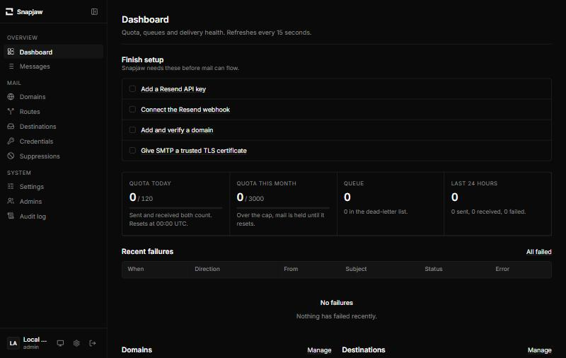
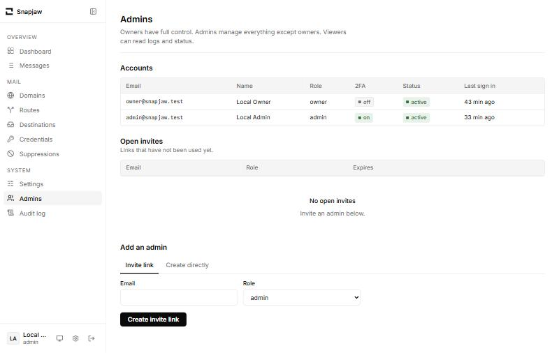

# Snapjaw

[](https://github.com/devs-des1re/snapjaw/actions/workflows/ci.yml)
[](LICENSE)
[](https://github.com/devs-des1re/snapjaw/pkgs/container/snapjaw)
[](package.json)

Snapjaw is a self-hosted email relay between [Resend](https://resend.com) and the mail clients you already use. Send as `hello@yourdomain.com` from Gmail, and get mail for `hello@yourdomain.com` in your Gmail inbox, without running a mail server.

It is not a mailbox, a webmail client or an MTA. It does not keep your mail. Message bodies live in a queue until delivery succeeds and are deleted right after. The log keeps metadata only.



## What it does

**Outbound.** Gmail's "Send mail as", or any app that speaks SMTP, logs in to Snapjaw on port 587 or 465. Snapjaw checks the sender against the credential's allowed addresses and sends the message through Resend's API, keeping headers, attachments, Reply-To, Message-ID and threading. Apps that use the Resend API can switch by changing only the base URL.

**Inbound.** Resend receives mail for your domain and tells Snapjaw through a signed webhook. Snapjaw fetches the original message and delivers it by route:

| Destination | How | Sender kept |
|---|---|---|
| Gmail API import | Imports the raw message into your Gmail | Yes |
| IMAP | Appends to any IMAP mailbox, Gmail with an app password included | Yes |
| Forward via Resend | Sends a new message, original sender in Reply-To | No, and costs quota |

A reconciler polls Resend for received mail the webhook missed, so downtime loses nothing. Deliveries are idempotent and survive restarts.

**Guard rails.** Never an open relay: authenticated submission only, per-credential allowed senders and rate limits. A quota guard tracks Resend usage (sent and received both count), alerts at 80%, and holds or rejects mail over the cap with a clear error. Bounces and complaints feed a suppression list. Loops are detected and refused.

**Admin.** Owners, admins and viewers, invites, TOTP two-factor authentication, per-device sessions, and an audit log of every admin action. Domains with live DNS status, routes, destinations, credentials, a searchable message log with each message's lifecycle, and health checks that tell you how to fix what is wrong.



## Quick start

```sh
mkdir snapjaw && cd snapjaw
curl -fsSLO https://raw.githubusercontent.com/devs-des1re/snapjaw/main/docker-compose.yml
curl -fsSL https://raw.githubusercontent.com/devs-des1re/snapjaw/main/.env.example -o .env
docker compose up -d
docker compose logs snapjaw
```

Open `http://your-server:3000/setup`, paste the setup token from the logs and create the first owner. Then follow the guides:

- [Self-hosting guide](docs/self-hosting.md): HTTPS, TLS for SMTP, Resend, DNS, backups.
- [Gmail setup guide](docs/gmail.md): Send mail as, and delivery into Gmail.

## Sending from an app

Create an API key under **Credentials**, then point the Resend SDK or plain HTTP at Snapjaw:

```sh
curl -X POST https://relay.example.com/api/emails \
  -H "Authorization: Bearer sj_xxxx_xxxxxxxx" \
  -H "Content-Type: application/json" \
  -H "Idempotency-Key: order-1234" \
  -d '{"from":"Billing <billing@example.com>","to":["customer@example.org"],"subject":"Your receipt","html":"<p>Thanks.</p>"}'
```

```ts
import { Resend } from "resend";

const resend = new Resend("sj_xxxx_xxxxxxxx", { baseUrl: "https://relay.example.com/api" });
await resend.emails.send({ from: "billing@example.com", to: "customer@example.org", subject: "Hi", text: "Hello" });
```

The request body is the same as Resend's `POST /emails`. Scheduled sends, templates and attachments by URL are not supported.

## Command line

```sh
docker compose exec snapjaw snapjaw doctor
docker compose exec snapjaw snapjaw admin create --email you@example.com
docker compose exec snapjaw snapjaw admin reset-2fa --email you@example.com
docker compose exec snapjaw snapjaw backup /data/backup.db
```

## Configuration

Everything except the values below is set in the admin UI.

| Variable | Purpose |
|---|---|
| `SNAPJAW_PUBLIC_URL` | Public https address of the admin UI |
| `SNAPJAW_SECRET_KEY` | 32-byte base64 key that encrypts stored secrets |
| `SNAPJAW_SMTP_HOSTNAME` | Host name SMTP clients connect to |
| `SNAPJAW_TLS_CERT`, `SNAPJAW_TLS_KEY` | Certificate and key for SMTP |
| `SNAPJAW_ACME_EMAIL` | Get a Let's Encrypt certificate instead |
| `SNAPJAW_METRICS_TOKEN` | Bearer token for `/metrics` |
| `SNAPJAW_TRUST_PROXY` | `true` behind a reverse proxy |

## Resend limits

The free plan allows 100 emails a day and 3,000 a month, and received mail counts against both. The API allows 10 requests per second. Snapjaw defaults to these numbers. Change them under **Settings** if your plan allows more.

## Development

```sh
npm install
cp .env.example .env
npm run dev
npm test
```

See [CONTRIBUTING.md](CONTRIBUTING.md), the [architecture](docs/architecture.md), the [decisions log](docs/decisions.md) and the [development notes](docs/development.md).

## Security

Report vulnerabilities privately. See [SECURITY.md](SECURITY.md).

## License

[MIT](LICENSE)
